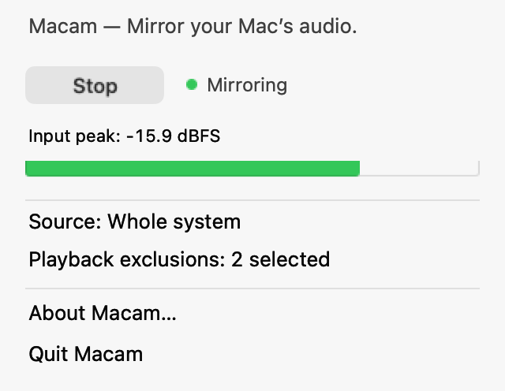

# Macam — Mac Audio Mirror

**Mirror your Mac’s audio.**

Macam mirrors system or application audio into a stereo input while leaving
original playback on its existing speakers or headphones. Keep the same output
devices and volume controls; select **Macam Audio** in the app receiving the copy.

**100% LLM-generated code.** The Macam-specific source, tests, and build scripts in
this version were generated by LLMs under human direction. Humans supplied the
requirements and runtime feedback. Attributed third-party adaptations retain their
upstream copyright and license; see [Code origin and credits](#code-origin-and-credits).
The [verification record](docs/verification.md) describes the checks actually performed.

## Why Macam?

- **Keep the original playback path.** Macam captures an unmuted copy. It does not
  mute the source and replace it with audio played back by Macam.
- **Keep the existing output setup.** No switching the system output, rerouting a
  source app into a virtual output, or creating a Multi-Output Device. Select
  Macam Audio only in the receiving app.
- **No separate driver installation.** Capture and the temporary input use macOS's
  built-in Core Audio APIs.
- **A small, free, open-source workflow.** One stereo mirror, a menu-bar control,
  and optional source/exclusion choices, with no accounts or network service.

## How it compares

| Project | Relevant workflow | Macam's distinction |
| --- | --- | --- |
| [FineTune](https://github.com/ronitsingh10/FineTune) | The inspected implementation mutes captured application output while tapped, then processes and plays the captured audio for volume/EQ/routing. | Macam keeps source playback unmuted and publishes a parallel input copy; it has no playback processing/replay path. |
| [BlackHole](https://github.com/ExistentialAudio/BlackHole) | Audio must be sent into the virtual driver's output. Its system-audio capture workflows can involve output routing or a Multi-Output Device. | Macam captures audio where it is already playing, preserving system defaults and source-app output settings. No BlackHole setup is required. |
| [Loopback](https://rogueamoeba.com/loopback/) | Configurable virtual devices, application/hardware sources, channel mapping, and monitoring. It can preserve normal app playback with “Mute when capturing” turned off. | Macam provides a narrower, free, open-source stereo mirror with unmuted capture by design and no separate driver installation. Loopback offers more extensive routing/mixing controls. |

FineTune's capture behavior is documented in the
[inspected tap implementation](https://github.com/ronitsingh10/FineTune/blob/2285279d36d3f8115c1c2d4aecd904f1bdf96a51/FineTune/Audio/Engine/ProcessTapController.swift).
BlackHole also supports routing through individual applications or other software;
changing the system default output is not mandatory for every BlackHole use case.
See its [Multi-Output setup guide](https://github.com/ExistentialAudio/BlackHole/wiki/Multi-Output-Device)
for one common system-audio workflow.

Preserving normal playback is **not unique to Macam**: Rogue Amoeba documents
[how Loopback can leave application playback on its original output](https://www.rogueamoeba.com/support/knowledgebase/?product=Loopback&showArticle=AppLatency).
Macam's distinction is its focused workflow and defaults, not a claim of better
measured latency, fidelity, or reliability. Macam remains experimental.



*AppKit component preview; the source/exclusion values are examples.*

## What Macam does

- Publishes **Macam Audio**, a stereo input for recording, transcription, calls,
  streaming, or any other application that accepts an audio input device.
- Mirrors system audio or selected applications, including Chrome and Safari.
- Offers **multiple optional playback exclusions**, with none enabled by default.
- Runs from a small menu-bar interface and starts only when asked.
- Works locally, with no accounts, networking, analytics, updates, or login service.

The receiving application handles recording; Macam has no built-in recorder.
Capture uses an unmuted Core Audio process tap and a temporary public aggregate input.

## Install

### Homebrew

```sh
brew install --cask universetraveller/tap/macam
```

Uses Macam's [project-maintained tap](https://github.com/universetraveller/homebrew-tap)
and checksummed release download. Requires Apple Silicon and macOS 14.2+.
The app is ad-hoc signed and not notarized; the first-launch approval described
below also applies to Homebrew installation. No developer tools or paid account
are needed.

Quit Macam before upgrading with `brew upgrade --cask universetraveller/tap/macam`.
See [Homebrew distribution](docs/homebrew.md) for maintenance and uninstall steps.

### Download a release

1. Open [GitHub Releases](https://github.com/universetraveller/macam/releases) and
   download **`Macam-<version>-arm64.zip`** from a published release's **Assets**.
   This is the Apple Silicon build (M1/M2/M3 and later). GitHub's **Source code**
   downloads contain source, not an installable app.
2. Quit any running Macam. Unzip the download and drag **Macam.app** into
   **Applications**, replacing the previous copy when upgrading.
3. Open Macam from Applications. It appears in the menu bar and starts stopped.
4. Follow [Mirror audio](#mirror-audio) below to grant capture permission and
   select Macam Audio in the receiving app.

No developer tools, separate driver, or installer service are needed for the
prebuilt app. It requires **macOS 14.2+**; recorded runtime checks currently cover
Apple Silicon on macOS 27.0.1. Intel prebuilt releases are not currently prepared.
Source builds are also available below.

Current packages are **ad-hoc signed and not notarized**. macOS may block the
first launch. If you trust the download, try opening it once, then go to
**System Settings → Privacy & Security → Open Anyway** and confirm. See
[Apple's opening instructions](https://support.apple.com/en-us/102445).

To check a download, also download its `.zip.sha256` sidecar into the same folder:

```sh
# Replace 0.3.0 with the version you downloaded.
shasum -a 256 -c Macam-0.3.0-arm64.zip.sha256
```

Updates are manual: quit, replace the app in Applications, and reopen it. Preferences
are retained; macOS may ask for capture permission again after replacement.
To uninstall, quit Macam and move the app to Trash. Quit removes its audio input;
no driver or background service needs uninstalling.

### Build from source

Build with Apple Command Line Tools and a **macOS 26+ SDK**. The runtime deployment
target is **macOS 14.2+**; verified runtime results currently cover Apple Silicon on
macOS 27.0.1. The Xcode IDE, an Xcode project, and downloaded packages are unnecessary.

If Command Line Tools are missing, run `xcode-select --install`. Then, from the checkout:

```sh
./scripts/build.sh
./scripts/run.sh
```

The locally signed app is `.build/Macam.app`, with bundle identifier
`org.macam.Macam`. It opens stopped. Quit before rebuilding or moving it, and keep
it at a consistent path for permissions. Builds use an ad-hoc signature by default;
an existing local identity can be selected with `MACAM_SIGN_IDENTITY='Identity name'`.
Rebuilding can require granting capture permission again. Packages are not notarized.

## Mirror audio

1. Open Macam's waveform menu and choose **Whole system** or source applications.
2. Leave **Playback exclusions: Off**, or check any applications you want omitted.
3. Click **Start** and allow **System Audio Recording** when macOS prompts.
4. In the receiving application, select **Macam Audio** as its input. A browser may
   show **Macam Audio (Aggregate)** and request microphone permission for the site.
5. Check the meters. The status beside Start/Stop opens full details when clicked.

Stop/Quit removes the input. A receiving app may reconnect after Start, need its
input reselected, or need permission renewed. Source/exclusion changes update the
existing tap without replacing the input.

### Multiple exclusions

Each checkmark excludes that application's playback, including its helpers.
Selections combine: for example, exclude Music and a meeting app while mirroring
other playback. Uncheck either to restore its capture, or use **Clear all (Off)**.
Exclusions persist across launches; an existing explicit exclusion from 0.2 is
migrated into the new set. Macam itself is always excluded.

**All browsers** can be combined with other exclusions. It conservatively covers
shared WebKit helpers too, which can include embedded web content in other apps.
Unchecking the group leaves any individually checked applications excluded.

### Chrome and Safari

All four routes passed user-observed non-silent checks on macOS 27.0.1 in version
0.2. The updated selection tests continue to cover these cases with exclusions Off:

| Source audio | Receiving web app | Source setting | Exclusions |
| --- | --- | --- | --- |
| Chrome | Chrome | Whole system or Google Chrome | Off |
| Safari | Safari | Whole system or Safari | Off |
| Chrome | Safari | Whole system or Google Chrome | Off |
| Safari | Chrome | Whole system or Safari | Off |

Capture is **per application, not per tab**. Selecting a browser includes playback
from its tabs/profiles; a receiving tab's playback can also be included. Keep input
monitoring/play-through off in the receiving app to avoid a feedback loop. Excluding
the source browser excludes its source tabs as well.

See the [browser test matrix](docs/browser-testing.md) for the exact evidence,
permission behavior, and limits. Protected content and website audio processing
can affect capture; disable echo cancellation, noise suppression, or automatic gain
when the receiving application permits and the workflow calls for it.

## Diagnostics and testing

Open **About Macam → Diagnostics** to select a browser and launch the offline
receiver or test-tone source. Permission help is there too. Both pages also work
as local files: [receiver](Resources/ReceiverTest.html), [tone source](Resources/ToneSource.html).
No web server or network requests are used. The source starts silent and plays a
quiet stereo tone only after Play; the receiver never monitors its input.

The receiver reports permission/device details, current stereo levels, and
`nonSilentInputVerified`. It supports qualified device names and already-authorized
Macam tracks when a browser hides device IDs. Granting input access can temporarily
open the browser's current input while names are discovered; that permission track
is closed on Connect/Stop or after 30 seconds and is never recorded or monitored.
The optional short recording belongs to the diagnostic receiving page and stays
in memory until explicitly saved.

For development:

```sh
./scripts/test.sh       # Build/sign, sanitized meter tests, selection/migration tests, browser mocks
./scripts/preview-ui.sh # Render Macam-owned AppKit components without capturing the screen
./scripts/package.sh    # Build a ZIP and SHA-256 checksum
./scripts/prepare-release.sh # Test/build, package, source, notes, checksums, provenance
```

After testing an existing build, `./scripts/package.sh --no-build` verifies its
signature and packages it without recompiling or changing the running app.

Node.js is optional for building/running Macam and required for the JS mock tests.
CI runs deterministic checks; it does not grant TCC or establish live browser capture.

Maintainers: see [Preparing releases](docs/releasing.md) for version bumps, local
review packages, and the tag-triggered workflow that creates an **unpublished draft**.
Release preparation requires Node.js for browser mocks and uses Python from
Command Line Tools; it downloads no build dependencies.

With menu-bar capture stopped and a source playing, native diagnostics can verify
independent input capture and unchanged device settings:

```sh
.build/Macam.app/Contents/MacOS/Macam --inspect
.build/Macam.app/Contents/MacOS/Macam --probe 30 --source com.apple.Safari
# In another terminal while the probe is running:
.build/Macam.app/Contents/MacOS/Macam --read 10
```

Repeat exclusions on the CLI, or clear earlier arguments with `--exclude none`:

```sh
.build/Macam.app/Contents/MacOS/Macam --probe 30 \
  --exclude com.apple.Music --exclude us.zoom.xos
```

`--receiver` remains a legacy alias for an explicit exclusion. Use `--help` for more
diagnostics, or `python3 scripts/verify.py --seconds 120 --source com.apple.Safari`
for the native integration suite. Reports remain in ignored `.build/verification/`.
Restricted command sandboxes can hide Core Audio; an empty device list is an error.

## System changes and recovery

Start creates only Macam's tap and aggregate input. Stop/Quit tears down callbacks,
aggregate, and tap. Default input/output devices, hardware sample rates, volumes,
and mute states are never written. Normal playback is not muted and replayed.
No driver, root service, Multi-Output Device, or launch-at-login item is installed.

An exclusive lock and exact-UUID ownership journal live in
`~/Library/Application Support/Macam/`. Preferences use `org.macam.Macam`; macOS
stores permissions and temporary aggregate configuration. After a crash, Macam
reclaims verified journaled resources. Manual cleanup is also available:

```sh
.build/Macam.app/Contents/MacOS/Macam --cleanup
```

Recovery refuses resources that do not match their ownership record. It never
removes unrelated devices based on a similar name or restores old settings over
the user's changes.

## Current limits

- No per-tab isolation, DSP/EQ, physical input mixing, or configurable channel mapping.
- Helper discovery uses ancestry, app paths, process notifications, and an optional
  guarded private responsibility lookup. Detached helper/relaunch behavior can vary.
- Device changes and sleep/wake have recovery hooks, but hardware switching and
  multi-hour drift still need manual verification. Receivers may need to reconnect.
- Runtime deployment targets beyond the recorded test environment remain unverified.
- Other local audio clients can enumerate the input while active, subject to macOS
  permissions. Stop capture when it is no longer needed.

## Code origin and credits

Macam's code was **100% LLM-generated under human direction**. The provenance
statement applies to this project's code-generation workflow; the project uses
Apple frameworks and includes attributed adaptations of upstream work.

[FineTune](https://github.com/ronitsingh10/FineTune) informed the helper-process
responsibility/ancestry lookup and resource lifecycle work. Those adaptations are
identified in the source and [THIRD_PARTY_NOTICES.md](THIRD_PARTY_NOTICES.md), with
the inspected revision and upstream copyright. Macam's unmuted public tap-only
input path does not include FineTune's playback processing or default-device management.

Primary API references: [Apple's process-tap sample](https://developer.apple.com/documentation/coreaudio/capturing-system-audio-with-core-audio-taps)
and [CATapDescription](https://developer.apple.com/documentation/coreaudio/catapdescription).

## Contribute

See [CONTRIBUTING.md](CONTRIBUTING.md), [SUPPORT.md](SUPPORT.md),
[SECURITY.md](SECURITY.md), and [CHANGELOG.md](CHANGELOG.md). Changes should preserve
the playback/ownership requirements and report real verification separately from mocks.

**License: GPL-3.0-only.** See [LICENSE](LICENSE). No warranty.
